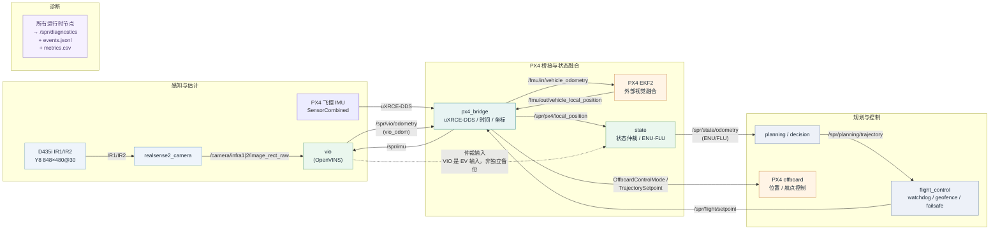

# SPR_Drone_27 项目需求与架构契约

> **版本：** v0.3（草案，包名按团队指定重写）
> **日期：** 2026-10-29
> **负责人：** SilverWolf（视觉里程计 / 总体框架）
> **状态：** 需求基线的候选版本。标有 **[待确认]** 的条目尚未由团队最终拍板，不构成冻结接口。

> **当前实施覆盖（2026-10-29，用户明确指定）：** 先使用 MAVLink 完成 IMU—相机标定测试，当前接受实测 ≥140 Hz；DDS 部分冻结，禁止执行暂存的切换脚本、改动 DDS 配置或固件。该阶段使用独立 `mavlink_calibration` profile 与 `/spr/calibration/imu`，不能声明原 DDS ≥200 Hz 运行时验收通过。其余标定质量与真实数据要求保留。见 [ADR 0002](docs/adr/0002-mavlink-calibration-phase.md)。

---

## 0. 文档约定

### 0.1 目的与权威性

本文是 SPR_Drone_27 的**唯一需求与架构契约来源**，回答四个问题：

1. 项目要做什么、为什么做（WHAT / WHY）；
2. 系统边界、接口和运行约束是什么（CONTRACT）；
3. 每个阶段怎样才算完成（ACCEPTANCE）；
4. 哪些决定已经拍板、哪些还开放（DECISIONS）。

实现细节和操作手册放在 `docs/`；架构决策记录放在 `docs/adr/`；消息/服务/动作定义放在 `src/drone_interfaces/`。**任何接口或需求变更必须通过 PR + ADR，不允许在代码、launch 或参数文件中静默修改。**

### 0.2 需求关键字与编号

- **必须（MUST）**：不满足就不能进入下一阶段或不能飞行。
- **应该（SHOULD）**：默认必须满足；不满足需要在 ADR 中说明理由。
- **可以（MAY）**：可选能力，不影响阶段验收。
- 需求编号格式：`REQ-<域>-<三位序号>`。域包括 `SYS`、`CAL`、`VIO`、`BRING`、`IF`、`FLT`、`SIM`、`DIA`。
- 每条需求必须有：验收标准、阶段标签、负责人。没有验收标准的需求不算需求。

### 0.3 阶段定义

| 阶段 | 名称 | 目标 | 当前状态 |
| --- | --- | --- | --- |
| **A0** | 框架与标定 | 统一工作区、配置/接口契约、完成一组可验证的相机—IMU 标定、OpenVINS 回放通过 | 进行中 |
| **A1** | VIO 与台架 | OpenVINS 在 Rock 4D 上稳定运行；VIO 经 PX4 EKF2 融合；SITL 位置保持 | 未开始 |
| **A2** | 首次自主飞行 | 室内、无 GPS、位置保持 + 航点飞行；安全链路和 failsafe 验证 | 未开始 |
| **A3+** | 扩展能力 | 静态避障、建图/探索、GPS 扩展、任务决策增强 | 路线图，不在本期验收 |

### 0.4 变更流程

1. 需求变更：提 PR 修改本文，说明变更原因、影响的包/接口、迁移方式。
2. 接口变更：先在 `docs/adr/` 记录决策，再改 `drone_interfaces`，版本号按语义化版本递增。
3. 标定/配置格式变更：必须同时更新 schema、导出器和回放测试。
4. 任何“临时绕过”（例如直接改 launch 里的话题名）都必须在 48 小时内回收为配置项，否则视为缺陷。

---

## 1. 背景、目标与范围

### 1.1 背景

SPR_Drone_27 是一架以**视觉惯性里程计（VIO）**为核心状态估计源的室内无人机项目。比赛/任务环境**不能使用 GPS/GNSS**；GPS 只作为未来的功能扩展选项，不能成为任何核心功能的前置依赖。

当前已有资产：

- 现有 `calibration/src/spr_calibration`（将迁入 `src/calibration` 并重命名为包 `calibration`）：D435i IR 双目标定采集与求解工具（C++ / ROS 2）；
- `open_vins`：OpenVINS 子模块（个人 fork，gitlink 固定在 6948812；根仓库尚未提交，升级/补丁策略未定义）；
- `Project.md`：本文件的前身，主要是一份标定系统的实施方案。

当前问题（已经观察到的）：

- 4 次采集会话全部没有可用图像，`calibration/results` 为空——标定链路尚未跑通；
- 根目录没有统一的 `src/` 工作区，`calibration/` 自带 `build/install`，`open_vins/` 在 `src/` 外；
- 话题、QoS、frame、时间策略散落在代码默认值、launch 参数和文档三处；
- 没有面向团队并行开发的接口契约、仿真环境和 CI；
- 没有定义 VIO 如何进入 PX4、谁负责 offboard/安全、规划器如何消费状态；
- 没有真实硬件上的 D435i 848×480@30 稳定性数据；主机上 640×480@30 曾掉线，424×240@15 才稳定。

### 1.2 项目目标

| 编号 | 目标 | 验收阶段 |
| --- | --- | --- |
| G1 | 完成 D435i 双目 + 飞控 IMU 的可复现标定，并导出 OpenVINS 配置 | A0 |
| G2 | OpenVINS 在 Rock 4D / ROS 2 Humble 上稳定运行，输出可用 VIO 里程计 | A1 |
| G3 | VIO 经 uXRCE-DDS 进入 PX4 EKF2，形成可飞的局部状态估计 | A1 |
| G4 | 室内、无 GPS 的位置保持与航点飞行 | A2 |
| G5 | 为 4–7 人团队提供冻结的接口、仿真环境和并行开发基线 | A0–A1 |
| G6 | 每次运行/采集/标定都可追溯（run_id、manifest、事件、指标） | A0 起 |
| G7 | 为后续避障、建图/探索和 GPS 扩展保留清晰接口 | A3+ |

### 1.3 第一阶段（A0–A2）范围

**必须做：**

- D435i 左右 IR（Y8）+ PX4 飞控 IMU；关闭 D435i depth/color/内置 IMU/IR 投影仪；
- 双目内参/畸变/外参标定；
- IMU 噪声（Allan）与相机—IMU 时空联合标定（Kalibr）；
- OpenVINS 双目 VIO 配置、回放验证、Rock 4D 部署；
- A0 起提供最小 `px4_bridge`（`SensorCombined`→`/spr/imu`，含 frame/时间/协方差语义），保证标定与运行时使用**同一 IMU 通路**；A1 再接入 EKF2/offboard；
- PX4 1.16 + uXRCE-DDS：VIO → EKF2 外部视觉融合；offboard 位置/航点控制；
- 统一的 bringup、诊断、日志、run 目录；
- PX4 SITL + Gazebo 仿真；给规划/决策团队的 fake odometry 与回放环境；
- 安全链路：RC override、watchdog、geofence、failsafe、飞行前检查。

**明确不做（第一阶段非目标）：**

- GPS/GNSS 定位；GPS 仅作为 A3+ 的可选扩展，默认关闭；
- Livox / Fast-LIO / `vehicle_simulator` 等 LiDAR 导航栈（属于其他项目/后续独立轨道，不在本仓库第一阶段）；
- 静态/动态避障；
- 建图、回环、全局重定位、探索；
- 室外、超视距、多机协同；
- 机载神经网络目标检测/识别（由其他项目提供时，只通过独立接口接入，不进入 VIO 契约）；
- 硬件时间同步触发接线（第一版使用软件时间同步）。

### 1.4 成功标准

第一阶段成功的定义不是“代码能编译”，而是：

1. 从干净仓库按文档一条命令完成 x86 Jazzy 和 ARM64 Humble 构建；
2. 在 Rock 4D 实机链路上采集一组标定数据，产出带 manifest 和验证报告的标定结果；
3. 同一组标定配置在 **SITL 或带真值参考的留出 bag** 上回放，OpenVINS 通过 ATE/RPE 门槛；没有真值来源时，只接受闭环漂移/重复性代理指标，不能伪造 ATE/RPE；
4. VIO 通过 uXRCE-DDS 进入 PX4 EKF2，SITL 中用**仿真双目/IMU 传感器**（不是 fake odometry）完成位置保持；
5. 真机室内完成位置保持 + 至少 3 个航点的自主飞行，全过程有日志、有 failsafe 验证；
6. 规划/决策团队在不接触硬件的情况下，能在 SITL + fake odometry 上开发和回归；fake odometry 只用于规划开发，不用于 VIO/EKF2 验收。

> **真值来源必须在 A0 的 ADR 中拍板**：动捕、全站仪、标定过的 AprilTag/Target 场，或明确声明“真机只做代理指标，ATE/RPE 仅在 SITL 计算”。没有真值系统时，禁止把 ATE 数值写成真机验收门槛。

---

## 2. 团队、职责与接口所有权

### 2.1 团队规模与角色

团队 4–7 人。角色可以兼任，但**每个包必须有唯一 owner**。

| 角色 | 职责 | 当前负责人 |
| --- | --- | --- |
| 框架 / VIO | 总体框架、需求约束、`drone_interfaces`、bringup、标定、OpenVINS、PX4 桥接、状态聚合、诊断 | SilverWolf |
| 规划（Planning） | 路径/轨迹生成、航点管理、约束检查 | 其他成员 |
| 导航 / 控制（Nav & Control） | 状态消费、控制律、offboard 行为、与 PX4 的飞行行为联调 | 其他成员 |
| 决策（Decision） | 任务状态机、行为选择、比赛策略 | 其他成员 |
| 仿真 / 测试 | SITL、Gazebo、fake odometry、回放、CI | 团队共享，需指定 owner |
| 硬件 / 安全 | 机体、相机、飞控、供电、RC、飞行前检查、飞行安全 | 团队共享，需指定安全负责人 |

### 2.2 包所有权（建议基线）

| 包 / 产物 | 职责 | Owner | 备注 |
| --- | --- | --- | --- |
| `drone_interfaces` | 所有自定义 msg/srv/action | 框架/VIO | 冻结后变更需 ADR；规划/决策有评审权 |
| `drone_bringup` | 唯一设备入口、launch、rig 配置 | 框架/VIO | 其他包不得自行打开相机/飞控 |
| `calibration` | 采集辅助、双目/IMU/联合标定、导出 | 框架/VIO | 不自行打开硬件 |
| `vio` | OpenVINS 集成、配置、适配器、状态发布 | 框架/VIO | 上游 OpenVINS 固定 commit |
| `px4_bridge` | uXRCE-DDS、PX4 时间/坐标转换、VehicleOdometry、IMU 转换 | 框架/VIO | 飞行关键路径 |
| `state` | 融合状态聚合、VIO/PX4 状态仲裁 | 框架/VIO **[待确认]** | 规划/控制消费此接口 |
| `flight_control` | offboard 状态机、watchdog、geofence、failsafe | 框架/VIO + 导航/控制共同评审 **[待确认]** | 安全集中，禁止规划器直接发 PX4 |
| `diagnostics` | 健康检查、事件、指标、报告 | 框架/VIO | 所有包必须上报状态 |
| `sim` | PX4 SITL、Gazebo、fake odometry、回放 | 仿真/测试 | 框架提供接口，仿真 owner 维护 |
| `planning` | 路径/轨迹 | 规划 | 只消费 `drone_interfaces` 契约 |
| `decision` | 任务/行为状态机 | 决策 | 只消费 `drone_interfaces` 契约 |
| `tools` | 离线 CLI、报告、数据转换 | 框架/VIO | 不承担运行时编排 |

### 2.3 接口所有权与冻结

- `drone_interfaces` 由框架/VIO 维护，规划/导航/决策团队有评审权。
- **A0 结束前冻结 `drone_interfaces` v0.1**，包括：`EstimatorStatus`、`FlightStatus`、`TrajectorySetpoint`、`MissionState`（以及必要的 service/action）。冻结后新增字段必须向后兼容；删除/改语义必须升 major 并给迁移说明。
- 每个包 README 必须写明：输入话题、输出话题、依赖的 frame、QoS、启动方式、owner。
- 规划/决策团队**不得**直接订阅 `px4_msgs` 或直接向 PX4 发指令；它们只与 `drone_interfaces` 和 `/spr/state/*` 交互。

### 2.4 硬件资源

**[待确认]** 当前已知：1 台 D435i、1 块 MicoAir743v2（PX4 1.16.0）、1 台 x86 开发机。以下必须由团队确认：

- 飞行平台数量、备用机数量；
- Rock 4D 数量、是否每台飞机一块；
- 标定台架数量（建议至少 2 套：相机 + 飞控 + 串口，供多人并行）；
- 电池、RC、遥控器、防护网/飞行场地；
- 谁有权限做真机飞行、谁负责安全。

**如果 4–7 人共享 1 架飞机，仿真和台架必须先行，否则团队会被硬件串行化。**

---

## 3. 系统上下文与运行环境

### 3.1 飞行平台（已确认/待确认）

| 项 | 值 | 状态 |
| --- | --- | --- |
| 飞控 | MicoAir743v2 | 已确认（USB 描述符） |
| 固件 | PX4 1.16.0（MAVLink heartbeat `autopilot=12`） | 已确认 |
| 机架 | `SYS_AUTOSTART=4001`（四旋翼 X） | 已确认 |
| 伴飞计算机 | Rock 4D，ARM64，ROS 2 Humble | 计划 |
| 相机 | Intel RealSense D435i，IR1/IR2，Y8，848×480@30（目标） | 硬件已确认；分辨率/帧率待在 Rock 4D 验证 |
| IMU | PX4 飞控 IMU（经 uXRCE-DDS） | 计划；D435i 内置 IMU 不可信 |
| GPS | 无；比赛禁用 | 已确认 |
| RC / 数传 | **[待确认]** 型号、通道、failsafe 配置 | 待确认 |
| 供电 | **[待确认]** 电池、BEC、伴飞计算机供电 | 待确认 |

**D435i 内置 IMU 的已知问题：** 2026-10-19 的 `Nav_test` 报告显示，静止时加速度模长约 5.44 m/s²（正常约 9.81），驱动日志提示 “IMU Calibration is not available”。因此本项目**必须**使用飞控 IMU，不能把 D435i 内置 IMU 作为 VIO 的惯性源。

### 3.2 计算与软件

| 层 | 环境 | 用途 |
| --- | --- | --- |
| 机载 | Rock 4D / Ubuntu 22.04 / ROS 2 Humble / PX4 uXRCE-DDS agent | 飞行运行时 |
| 开发机 | Ubuntu 24.04 x86_64 / ROS 2 Jazzy | 开发、仿真、离线标定、CI |
| 标定容器 | x86 + ROS 1 Noetic（Kalibr） | 相机—IMU 联合标定；只离线 |
| 仿真 | x86 + PX4 SITL + 与 PX4 1.16 匹配的 Gazebo | 规划/决策/控制并行开发 |

依赖版本必须固定：PX4 1.16.x、`px4_msgs` 对应版本、OpenVINS 固定 commit、OpenCV/Ceres/Eigen 版本在 Dockerfile 和 `docs/environment.md` 中记录。禁止“最新 master”作为构建输入。

### 3.3 网络与 DDS

- 机载所有节点运行在同一台 Rock 4D 上；飞行关键链路**不跨 Wi-Fi**。
- DDS 只在本机回环使用；地面站通过 rosbag2 / Foxglove / 自定义上传获取数据，不把 DDS 暴露到飞行网络。
- 固定 RMW 实现（Fast DDS 或 Cyclone DDS，二选一）并在两端一致；Docker 内注意共享内存和 `ROS_LOCALHOST_ONLY`。
- 禁止在飞行中依赖外部网络、云端服务或时间服务器。

### 3.4 ROS 发行版矩阵

| 项 | 机载 Humble | 开发机 Jazzy | 规则 |
| --- | --- | --- | --- |
| 消息 | `sensor_msgs`/`nav_msgs`/`geometry_msgs` | 同左 | 只使用跨版本稳定的标准消息 |
| 自定义消息 | `drone_interfaces` | `drone_interfaces` | 两端必须同一版本；禁止跨版本混用 |
| 录包 | rosbag2 SQLite3 | 可读 | 转换/回放前校验消息定义和数量 |
| 构建 | `colcon build` | `colcon build` | CI 两个环境都要过 |

---

## 4. 系统架构

### 4.1 数据流



> 实线 = 数据/命令；点线 = 仲裁/诊断。话题命名空间为 `/spr/...`，消息类型为 `drone_interfaces/...`。PX4 内部 NED/FRD 只在 `px4_bridge` 出现，图中的 `state` 输出统一为 ENU/FLU。Mermaid 源：[docs/diagrams/data_flow.mmd](docs/diagrams/data_flow.mmd)；渲染导出：[docs/diagrams/data_flow_mermaid.svg](docs/diagrams/data_flow_mermaid.svg)。

### 4.2 包结构（目标）

```text
SPR_Drone_27/
├── src/
│   ├── drone_interfaces/          # msg/srv/action，冻结契约
│   ├── drone_bringup/             # 唯一设备入口、launch、rig 配置
│   ├── calibration/         # 采集/求解/导出
│   ├── vio/                 # OpenVINS 集成、配置、适配
│   ├── px4_bridge/          # uXRCE-DDS、时间/坐标转换
│   ├── state/               # 状态聚合与仲裁
│   ├── flight_control/      # offboard、watchdog、geofence、failsafe
│   ├── diagnostics/         # 健康、事件、指标
│   ├── sim/                 # SITL、Gazebo、fake odometry、回放
│   ├── tools/               # 离线 CLI、报告
│   ├── planning/            # 规划（其他成员）
│   ├── decision/            # 决策（其他成员）
│   └── open_vins/               # 子模块，固定 commit
├── config/                      # 仅存放 schema 和站点覆盖，不复制包内默认值
├── docs/                        # 接口、坐标、时间、标定、飞行、ADR
├── docker/                      # x86 标定/仿真、ARM64 运行时
├── runs/                        # 运行数据（git 忽略）
└── build/ install/ log/         # 构建产物（git 忽略）
```

> 包名与运行时节点名按团队约定：`drone_interfaces`、`drone_bringup` + 小写包名（`calibration`/`vio`/`px4_bridge`/`state`/`flight_control`/`diagnostics`/`sim`/`tools`/`planning`/`decision`）。全部小写，符合 ROS 2/REP 144。节点名与包名一致（如 `vio`、`px4_bridge`、`state`、`flight_control`）。ROS 话题命名空间保持 `/spr/...`（项目命名空间，不随包名变化）；消息类型使用 `drone_interfaces/...`。
>。

### 4.3 进程与执行模型

| 进程 | 运行位置 | 执行模型 | 说明 |
| --- | --- | --- | --- |
| `microxrce_agent` | 机载电脑 | 系统级、非 ROS | PX4 uXRCE-DDS agent；持有飞控串口设备锁；先于 bridge 启动 |
| `realsense2_camera` | 机载电脑 | 多线程 | 只发布 IR 流和 camera_info；关闭 depth/color/IMU/投影；按序列号选设备 |
| `vio`（OpenVINS） | 机载电脑 | 独立进程，内部线程 | 不与其他节点共享 executor；避免被 GUI/日志阻塞 |
| `px4_bridge` | 机载电脑 | 独立进程 | 高频 IMU/odometry，必须低延迟 |
| `state` | 机载电脑 | 独立进程 | 状态聚合/仲裁；不自动重启 |
| `flight_control` | 机载电脑 | 独立进程 | offboard 与安全，最高优先级；不自动重启 |
| `planning` / `decision` | 机载电脑 | 独立进程 | 允许重启，不影响飞行控制 |
| `diagnostics` | 机载电脑 | 独立进程 | 1 Hz 汇总，不逐帧打日志 |
| `recorder` | 机载电脑 | 独立进程 | rosbag2 常驻录制；由 `diagnostics` 包提供；按 topic 清单和磁盘水位启停 |
| 标定采集/求解 | x86 或 Rock 4D | 独立进程 | 离线，不进入飞行 |

**运行时监督（非 ROS 进程也算）：**

- `drone_bringup`（或其 systemd unit）负责按顺序启动 `microxrce_agent` → `realsense2_camera` → `px4_bridge` → `vio` → `state` → `flight_control` → `planning/decision` → `recorder`；关闭时逆序。
- 飞控串口的设备锁由 `microxrce_agent` 持有；`drone_bringup` 负责检查串口占用，**不允许** ROS 节点再打开同一 UART。
- `microxrce_agent` 崩溃 = bridge 同时失去 IMU、`vehicle_status`、`failsafe_flags`；bridge 必须发布链路失效事件，`flight_control` 在 `vehicle_status` 超时后停止 `OffboardControlMode`，依赖 PX4 `COM_OF_LOSS_T` 进入 failsafe。
- `state` / `flight_control` 在飞行中**不自动重启**；崩溃即停止发布 offboard setpoint，并写 `events.jsonl`。`vio` / `px4_bridge` 重启必须触发安全状态，不能静默恢复。
- `recorder` 在每次飞行中常驻；磁盘水位低于阈值时有序停止并记录失败，不能拖垮飞行节点。

**运行时禁止：**

- OpenCV GUI / `waitKey` / `imshow`；
- 在图像回调里同步写 PNG/rosbag（写盘必须异步或由 rosbag2 处理）；
- 在飞行关键节点里做阻塞式文件 IO、网络请求、参数重配置；
- 规划/决策节点直接发布 `px4_msgs`。

### 4.4 时间域（关键契约）

**统一时间域：机载主机 ROS 时间（`CLOCK_REALTIME`，由 `rclcpp::Clock` 发布）。** 所有跨模块时间戳必须能追溯到这一时间域。

| 源 | 原始时间 | 转换 | 说明 |
| --- | --- | --- | --- |
| D435i 图像 | 设备时间或主机时间 | 读取驱动发布的 `frame_timestamp_domain`（`HARDWARE_CLOCK`/`SYSTEM_TIME`），由 bridge 显式映射到主机时间 | **realsense-ros 4.58.4 不暴露 `global_time_enabled` 参数**；禁止在 launch/文档引用不存在的参数名。必须记录实际时间域与映射方式 |
| PX4 IMU / uORB | PX4 boot time（µs） | `px4_bridge` 估计 `T_host_px4` 偏移，转成主机时间 | 偏移在启动/重连时估计，运行中监测漂移；精度预算 \|error\| ≤1 ms |
| OpenVINS | 主机时间 | 直接使用 | `timeshift_cam_imu` 由 Kalibr 初始化，`calib_cam_timeoffset=true` 在线微调 |
| PX4 `VehicleOdometry` | PX4 boot time | bridge 反向转换成 PX4 时间 | 必须带 `timestamp_sample`；`reset_counter` 透传 |
| rosbag2 | 记录时的 ROS 时间 | 回放时保持 | SITL 使用 `use_sim_time=true` |

**`SensorCombined` 的采样语义（依据 ADR 0001 修正）：** 该消息没有 `timestamp_sample`；`timestamp` 是陀螺积分终点，`gyro_rad` / `accelerometer_m_s2` 是积分区间平均值。bridge 使用 `timestamp - gyro_integral_dt/2`，按加速度相对终点插值到该中点，并在配置中记录；不能用接收时刻替代。PX4 1.16 开启 `UXRCE_DDS_SYNCT=1` 时 DDS 已将时间戳映射到 agent 主机时间，bridge 必须验证同步质量而不能再次叠加偏移；原始 boot time 模式需另行显式实现。详见 [ADR 0001](docs/adr/0001-a0-workspace-and-time.md)。

**强制规则：**

- 禁止混用设备时间、PX4 boot time、主机时间而不做显式转换；
- 禁止在飞行中让系统时钟发生阶跃（NTP 只允许 slew；或飞行期间禁用外部对时）；
- 必须监测时间倒退、跳变、长间隔、相机—IMU 残余偏移，并写入 `/spr/diagnostics` 与 `events.jsonl`；
- 重连后必须结束当前连续段、重新估计偏移，不能沿用旧偏移；
- 必须定义 `T_host_px4` 的估计协议（uXRCE-DDS TimesyncStatus 或带 RTT 的偏移估计）、精度预算（≤1 ms）和重估策略；若运行时重估，必须记录 `Δoffset`，并明确它与 Kalibr `timeshift_cam_imu` 的合成方式（`t_imu = t_cam + timeshift_cam_imu + Δoffset`，或锁定标定会话偏移）；
- Kalibr 的 `timeshift_cam_imu` 只作为初值，不能当作运行时唯一同步手段。

### 4.5 坐标与 TF（关键）

| Frame | 定义 | 发布者 |
| --- | --- | --- |
| `world` | ENU，z 向上；原点在**首次 armed 或首次有效 EV** 时锚定，不随 VIO 初始化/重置改变 | `state`（唯一动态 TF 权威） |
| `odom` | ENU，连续、无跳变；PX4 EKF2 reset 时由 `state` rebase | `state` |
| `base_link` | FLU（x 前、y 左、z 上） | `state` |
| `vio_odom` | VIO 局部帧，原点为 OpenVINS 初始化点；不是起飞点 ENU | `vio` 只发布 Odometry；`world→vio_odom` 由 `state` 在锚定时发布 |
| `imu_link` | FLU（PX4 内部 FRD 由 bridge 转换） | `drone_bringup` 静态 TF |
| `camera_link` | 相机机械坐标系 | `drone_bringup` 静态 TF |
| `cam0_optical` / `cam1_optical` | REP-103 optical（z 前、x 右、y 下） | `drone_bringup` 加载标定外参的静态 TF |
| PX4 NED/FRD | 只在 `px4_bridge` 内部出现 | 不对外发布 |

**规则：**

- VIO 在任意位姿初始化，内部 `global` 帧的原点和 yaw 由初始化瞬间决定，**不可能直接输出原点为起飞点的 ENU**。`vio` 只发布 `/spr/vio/odometry`，`frame_id=vio_odom`，`child_frame_id=imu_link`（或经显式外参的 `base_link`）；必须重写 OpenVINS 硬编码的 `global`/`imu`/`cam#` frame，并关闭 `publish_global_to_imu_tf`。
- `state` 是唯一动态 TF 权威，维护 `T_world_vio`（首次 armed/首次有效 EV 时锚定），发布 `world→odom→base_link`；**静态外参链只由 `drone_bringup`（URDF/static_transform_publisher）发布**，`state` 不发布静态链，避免双父节点。
- 启动/预检顺序：VIO 初始化 OK → `state` 锚定 `T_world_vio` → `px4_bridge` 开始发送 EV → 允许 armed。任何一步缺失都必须拒绝解锁；`T_world_vio` 不可用时 bridge 不得发送 `VehicleOdometry`。
- PX4 `VehicleLocalPosition` 的 local 原点会随 EKF2 的 xy/z/heading reset 改变。`px4_bridge` 必须透传 `reset_counter`、`xy_valid`、`z_valid`、`v_xy_valid`、`dead_reckoning` 等有效性字段；`state` 按 reset 事件 rebase `odom`，保证 `odom` 连续、`world` 不动，并写 `events.jsonl`。
- “VIO 兜底”必须定义仲裁：`state` 支持 `AUTO` / `PX4_EV` / `VIO_ONLY` 三种模式，切换条件至少包括 EV 健康、协方差、超时、reset；**如果 VIO 本身就是 EKF2 的 EV 输入，它不是独立备份**，不能按字面实现成双源投票，否则会造成状态跳变。
- 除 `px4_bridge` 外，任何节点不得做 ENU↔NED、FLU↔FRD 转换；`flight_control` 输出 ENU/FLU setpoint，由 bridge 统一转换。
- 标定文件使用 `T_A_B` 约定：把 B 坐标系中的点变换到 A 坐标系；`T_cam_imu` 表示 IMU→相机；
- `t_imu = t_cam + timeshift_cam_imu`，符号遵循 Kalibr YAML；
- 所有 TF 必须有明确的 timestamp；A0 结束前用已知向量做一次坐标/四元数/ENU-FLU 方向测试，并用 `tf2` 检查无重复父节点/断树。

### 4.6 配置真源

| 配置 | 位置 | 内容 | 校验 |
| --- | --- | --- | --- |
| `rig.yaml` | `drone_bringup/config/rig/` | 相机序列号/USB 路径、飞控串口/by-id、流参数、话题、frame、QoS、时间策略、`imu_frame_id`、`T_imu_raw_imu_link`、`timestamp_source`、`min_rate`/`max_gap` | JSON Schema + 启动预检 |
| `vio.yaml` | `vio/config/` | OpenVINS 配置、特征数、跟踪频率、时间偏移开关、输出 frame 映射 | OpenVINS 解析 + 回放 |
| `px4.yaml` | `px4_bridge/config/` | uXRCE-DDS 端口、EKF2 EV 参数、offboard 频率、failsafe、参数文件路径 | 参数 apply/readback + diff |
| `px4/params/<airframe_id>.params` | `config/px4/` | 机架/执行器/RC/电池/EKF2/uXRCE-DDS 完整参数基线 | 写入后逐项回读，与基线 diff |
| `calibration.yaml` | `calibrations/<id>/manifest.yaml` | 标定 ID、哈希、文件路径、真值来源 | 运行时哈希校验 |

**禁止：**

- 代码里 `declare_parameter` 的默认值与 launch 参数、YAML 三处重复；
- 在 launch 中硬编码设备序列号、话题名、分辨率；
- 用“文档里写着”代替 schema 校验。

---

## 5. 接口契约

### 5.1 话题与 QoS（v0.1）

| 话题 | 类型 | 方向 | QoS | 频率 | 说明 |
| --- | --- | --- | --- | --- | --- |
| `/camera/infra1/image_rect_raw` | `sensor_msgs/Image` | 驱动→VIO | reliable, depth 5 | 目标 30 Hz | Y8；OpenVINS 双目订阅为 reliable |
| `/camera/infra2/image_rect_raw` | `sensor_msgs/Image` | 驱动→VIO | reliable, depth 5 | 目标 30 Hz | 同上 |
| `/camera/infra1/camera_info` | `sensor_msgs/CameraInfo` | 驱动→VIO | reliable, depth 5 | 30 Hz | 与图像同源 |
| `/camera/infra2/camera_info` | `sensor_msgs/CameraInfo` | 驱动→VIO | reliable, depth 5 | 30 Hz | 同上 |
| `/spr/imu` | `sensor_msgs/Imu` | bridge→VIO | best_effort, depth 100 | ≥200 Hz（目标） | 由 `px4_msgs/SensorCombined` 转换 |
| `/spr/vio/odometry` | `nav_msgs/Odometry` | VIO→bridge/state | reliable, depth 10 | ≥20 Hz | `vio_odom`→`imu_link`（或经外参 `base_link`），带协方差；不发布 TF |
| `/spr/vio/status` | `drone_interfaces/EstimatorStatus` | VIO→all | best_effort, depth 5 | 10 Hz | 初始化/退化/丢失 |
| `/spr/px4/local_position` | `nav_msgs/Odometry` | bridge→state | reliable, depth 10 | ≥30 Hz | PX4 EKF2 融合状态，已转 ENU/FLU；reset/validity 见 `/spr/px4/status` |
| `/spr/px4/status` | `drone_interfaces/EstimatorStatus` | bridge→all | best_effort, depth 5 | 10 Hz | `reset_counter`、`xy_valid`、`z_valid`、`v_xy_valid`、`dead_reckoning` |
| `/spr/state/odometry` | `nav_msgs/Odometry` | state→planner | reliable, depth 10 | ≥30 Hz | `world`→`base_link`；PX4 融合为主，VIO 仅在定义的模式下参与 |
| `/spr/state/status` | `drone_interfaces/EstimatorStatus` | state→all | best_effort, depth 5 | 10 Hz | 融合状态健康与当前仲裁模式 |
| `/spr/planning/trajectory` | `drone_interfaces/TrajectorySetpoint` | planner→flight_control | reliable, depth 5 | 20–50 Hz | ENU/FLU，带有效期 |
| `/spr/flight/setpoint` | `drone_interfaces/TrajectorySetpoint` | flight_control→bridge | reliable, depth 5 | ≥20 Hz | 已通过 watchdog/geofence 的 setpoint |
| `/spr/flight/status` | `drone_interfaces/FlightStatus` | flight_control→all | best_effort, depth 5 | 10 Hz | 模式、armed、failsafe |
| `/spr/diagnostics` | `diagnostic_msgs/DiagnosticArray` | all→diagnostics | best_effort, depth 5 | 1 Hz | 标准诊断 |
| `/fmu/in/vehicle_odometry` | `px4_msgs/VehicleOdometry` | bridge→PX4 | PX4 默认 | 30–50 Hz | NED/FRD，PX4 时间 |
| `/fmu/in/offboard_control_mode` | `px4_msgs/OffboardControlMode` | bridge→PX4 | PX4 默认 | ≥20 Hz | 由 bridge 统一发布 |
| `/fmu/in/trajectory_setpoint` | `px4_msgs/TrajectorySetpoint` | bridge→PX4 | PX4 默认 | ≥20 Hz | 由 bridge 统一转换/发布 |
| `/fmu/out/vehicle_local_position` | `px4_msgs/VehicleLocalPosition` | PX4→bridge | PX4 默认 | ≥30 Hz | EKF2 融合输出；bridge 转 ENU/FLU |
| `/fmu/out/vehicle_status` | `px4_msgs/VehicleStatus` | PX4→flight_control | PX4 默认 | 10 Hz | |
| `/fmu/out/failsafe_flags` | `px4_msgs/FailsafeFlags` | PX4→flight_control | PX4 默认 | 10 Hz | |
| `/fmu/out/sensor_combined` | `px4_msgs/SensorCombined` | PX4→bridge | PX4 默认 | ≥200 Hz（目标） | 飞控 IMU |

**QoS 规则：**

- 传感器流默认 `best_effort`；图像因 OpenVINS 上游双目订阅默认 reliable，v0.1 暂取 reliable depth 5，A1 用延迟测试决定是否改为 best_effort 并给 OpenVINS 打 QoS 补丁。
- 命令/轨迹/状态必须 reliable；诊断/状态类可以 best_effort。
- 任何 QoS 变更必须同时改本文、`rig.yaml` 和预检脚本。

### 5.2 自定义接口（`drone_interfaces` v0.1）

```text
msg/EstimatorStatus.msg
  std_msgs/Header header
  uint8 state              # 0=UNINITIALIZED,1=INITIALIZING,2=OK,3=DEGRADED,4=LOST
  uint8 source             # 0=VIO,1=PX4_EV,2=STATE
  uint8 mode               # 0=AUTO,1=PX4_EV,2=VIO_ONLY
  uint32 feature_count
  uint32 msckf_features
  uint32 slam_features
  float32 residual_rms
  float32 time_offset_s
  float32 latency_ms
  uint32 reset_counter
  bool xy_valid
  bool z_valid
  bool v_xy_valid
  bool dead_reckoning
  string message

msg/FlightStatus.msg
  std_msgs/Header header
  uint8 mode               # IDLE, TAKEOFF, HOLD, GOTO, LAND, ABORT
  bool armed
  bool failsafe
  bool ekf_ev_healthy
  float32 battery_voltage
  float32 setpoint_age_ms
  string message

msg/TrajectorySetpoint.msg
  std_msgs/Header header     # frame_id = world
  geometry_msgs/Point position
  geometry_msgs/Vector3 velocity
  geometry_msgs/Vector3 acceleration
  float32 yaw
  float32 yaw_rate
  float32 valid_until_s      # 0 = 使用默认超时
  string constraints_json

msg/MissionState.msg
  std_msgs/Header header
  uint8 state
  string mission_id
  string message
```

- 服务：`std_srvs/Trigger` 用于 `reset_estimator`、`start_mission` 等简单动作；复杂任务用 action（A3+ 再定）。
- 所有消息必须带 `header.stamp` 和 `frame_id`；没有例外。
- 字段只增不改语义；删除字段或改单位必须升 major。

### 5.3 规划器 ↔ 框架边界（建议，[待确认]）

- 规划/决策只发布 `/spr/planning/trajectory`（`TrajectorySetpoint`，`frame_id=world`，ENU/FLU），不直接发布 `px4_msgs`。
- `flight_control` 是唯一允许做 offboard 状态机与安全裁决的节点；它负责：
  - offboard 模式切换与保持；
  - setpoint 超时 watchdog；
  - geofence、高度限制、速度限制；
  - RC override / kill switch / 电池 failsafe；
  - 把通过安全检查的 setpoint 发到 `/spr/flight/setpoint`；
  - `/spr/flight/status` 发布。
- `px4_bridge` 是唯一允许发布 `px4_msgs` 控制消息到 PX4 的节点；它负责 ENU/FLU → NED/FRD、主机时间 → PX4 时间的最终转换，并发布 `OffboardControlMode` / `TrajectorySetpoint`。
- 规划/决策消费 `/spr/state/odometry`（PX4 EKF2 融合后的 ENU/FLU 状态）和 `/spr/flight/status`；不直接消费原始 VIO，除非做诊断。
- 这样划分的理由：安全逻辑集中、规划器可独立重启、VIO 替换不影响规划接口。

### 5.4 标定产物契约

```text
calibrations/<calib_id>/
├── manifest.yaml              # 输入、git、配置、哈希、时间、工具版本
├── camchain.yaml              # 双目内参/畸变/外参
├── imu.yaml                   # Allan 噪声/随机游走
├── kalibr_imucam_chain.yaml   # 相机—IMU 外参 + timeshift
├── openvins/
│   ├── estimator_config.yaml
│   └── kalibr_imucam_chain.yaml
├── validation/
│   ├── replay_metrics.yaml    # 指标；含 reference.source/accuracy；无真值则不得输出 ATE/RPE
│   └── report.html
└── report.pdf                 # Kalibr 原始报告
```

- **不要复制 OpenVINS 的 `rs_d455` 模板**：它是单目 color + D455 内置 IMU（`max_cameras: 1`、`rostopic: /d455/color/image_raw`），与本站 D435i IR 双目 + 飞控 IMU 不匹配。`kalibr_imucam_chain.yaml` 中的 `rostopic` 会覆盖 launch 的 `topic_camera*` 参数；项目自有配置必须显式写 `max_cameras: 2`、`use_stereo: true`、`cam0/cam1` 的 IR 话题，并在启动日志中回显实际话题/frame。
- 标定对象是驱动已矫正的 `image_rect_raw`，radtan 应接近 0；若切换到 `image_raw`、改变驱动版本或流模式，必须重标定。报告要记录驱动版本、流模式、曝光/增益。
- `replay_metrics.yaml` 必须写明 `reference.source`（SITL GT / mocap / AprilTag field / none）与 `reference.accuracy`；没有参考轨迹时只输出闭环漂移、重复性、重投影误差等代理指标，不能伪造 ATE/RPE。

- `calib_id = <UTC 日期>_<git short hash>_<输入哈希前 8 位>`。
- 所有中间产物使用标准 YAML 1.1/1.2 或 JSON；**禁止**用 OpenCV `FileStorage` 的 `%YAML:1.0` 作为跨语言交换格式（PyYAML 无法解析 `%YAML:1.0`，已在本机 `meta.yaml` 上复现）。OpenVINS 需要的 `%YAML:1.0` 只在最终导出时生成。
- 运行时启动必须校验 `manifest.yaml` 中的哈希与当前 `calibration.yaml` 一致；不一致则拒绝启动并报诊断事件。
- 没有通过留出 bag 验证的标定结果**不得**进入 `calibrations/`。

### 5.5 PX4 接口

- 使用 PX4 1.16 + uXRCE-DDS；`px4_msgs` 固定在匹配版本。
- `px4_bridge` 负责：
  - `px4_msgs/SensorCombined` → `sensor_msgs/Imu`（时间、单位、frame、协方差）；**A0 就交付这一最小路径**，标定与运行时必须使用同一 bridge 版本；
  - `/spr/vio/odometry`（`vio_odom`）+ `T_world_vio` → `px4_msgs/VehicleOdometry`（NED/FRD、PX4 boot time、协方差、quality、`reset_counter`）；不得把 `vio_odom` 当成世界 ENU；
  - `px4_msgs/VehicleLocalPosition`（NED）→ `/spr/px4/local_position`（ENU/FLU）；透传 `reset_counter`/`xy_valid`/`z_valid`/`v_xy_valid`/`dead_reckoning` 到 `/spr/px4/status`；由 `state` 聚合为 `/spr/state/odometry`；
  - PX4 参数检查/回读：`EKF2_EV_CTRL`、`EKF2_EV_DELAY`、`EKF2_EV_POS_X/Y/Z`、`EKF2_GPS_CTRL=0`、`COM_ARM_WO_GPS=1`、`COM_OF_LOSS_T`、`UXRCE_DDS_CFG`，以及 `config/px4/params/<airframe_id>.params` 中的机架/执行器/RC/电池基线。
- `state` 维护并发布 `T_world_vio`（首次 armed/首次有效 EV 时锚定）；bridge 通过 TF 查询该变换，把 VIO 里程计送入 PX4。
- MAVROS 允许用于地面站/调试/参数查看，但**不得**进入飞行关键路径；禁止两套 PX4 接口同时发控制指令。标定数据禁止来自 MAVROS IMU，必须来自与运行时相同的 bridge。
- 无 GPS：`EKF2_GPS_CTRL=0`，外部视觉提供水平/垂直位置、速度、yaw；必须用已知向量测试 NED/FRD 与四元数方向。
- PX4 参数必须有版本化真源和 apply/verify：写入后逐项回读、与基线 diff，不一致非零退出；参数文件 hash、固件版本、FCU 传感器校准状态写入 manifest。

---

## 6. 需求清单

> 说明：每条需求都应有 owner 和阶段。`[待确认]` 表示默认方案尚未团队拍板。

### 6.1 系统与工程（SYS）

| ID | 需求 | 验收 | 阶段 | Owner |
| --- | --- | --- | --- | --- |
| REQ-SYS-001 | **必须**只有一个根 colcon 工作区：所有包在 `src/` 下，`open_vins` 作为子模块固定在 `src/open_vins` | 干净 clone 后根目录 `colcon build` 一次构建全部包 | A0 | 框架 |
| REQ-SYS-002 | **必须**固定所有外部依赖：子模块 commit、`.repos`、Docker digest、`px4_msgs`/OpenVINS 版本 | `vcs export --exact` + `git submodule status` + 镜像 digest 可复现 | A0 | 框架 |
| REQ-SYS-003 | **必须**有 CI：x86 Jazzy 构建、单元测试、launch_test、回放 smoke；ARM64 Humble 至少交叉/QEMU 或原生 runner | PR 必须通过 CI 才能合并 | A0 | 仿真/测试 |
| REQ-SYS-004 | **必须**配置单一真源：`rig.yaml`/`vio.yaml`/`px4.yaml`，JSON Schema 校验，禁止三处重复默认值 | schema 测试 + 启动预检失败用例 | A0 | 框架 |
| REQ-SYS-005 | **必须**冻结 `drone_interfaces` v0.1 并语义化版本化 | 接口变更 ADR + 版本号 + 两端构建通过 | A0 | 框架 |
| REQ-SYS-006 | **必须**有文档索引：`docs/index.md`、坐标、时间、接口、标定、飞行、ADR | 新成员按文档可在 1 天内跑通 SITL | A0 | 框架 |
| REQ-SYS-007 | **必须**有仓库治理：初始提交、分支保护、CODEOWNERS、PR 评审、issue 模板 | 仓库有 main 分支保护；每个包有 owner | A0 | 团队 |
| REQ-SYS-008 | **必须**有可复现容器：x86 标定/仿真镜像、ARM64 运行时镜像；USB/串口/网络透传文档化 | 干净机器按文档构建/运行成功 | A0 | 框架 |
| REQ-SYS-009 | **应该**仿真优先：规划/决策在 SITL + fake odometry 上开发，不依赖真机 | 规划团队无硬件可完成一次航点回归 | A0 | 仿真/测试 |
| REQ-SYS-010 | **必须**在任何标定/飞行前完成根仓库首次 commit 和 tag；manifest 用 `git describe --tags --always --dirty` 记录代码基线 | `git log` 非空；`git submodule status` 有输出；tag 可引用 | A0 | 框架 |

### 6.2 标定（CAL）

| ID | 需求 | 验收 | 阶段 | Owner |
| --- | --- | --- | --- | --- |
| REQ-CAL-001 | **必须**完成 D435i IR1/IR2 双目内参、radtan 4 参数畸变、相对外参标定 | 848×480@30 实测确认的等价 profile；≥30 对采集、≥20 对最终、stereo RMS ≤0.5 px、单图 ≤1.0 px、覆盖率 ≥80% | A0 | 框架 |
| REQ-CAL-002 | **必须**用 rosbag2 记录原始双目 + IMU；PNG/索引只是派生数据 | bag 可回放、消息数/时间戳/载荷校验通过 | A0 | 框架 |
| REQ-CAL-003 | **必须**完成飞控 IMU 的 Allan 噪声分析（静止 ≥1 h，不足则延长） | `imu.yaml` 含噪声密度/随机游走/拟合报告，无默认占位值 | A0 | 框架 |
| REQ-CAL-004 | **必须**完成相机—IMU 时空联合标定（Kalibr），输出外参与 timeshift | 留出 bag 重投影误差达标；time offset 有符号检查；PDF 报告归档 | A0 | 框架 |
| REQ-CAL-005 | **必须**报告 RMS 之外的质量：参数不确定度、相关性、留出集误差、覆盖率 | 报告中每项可见；不达标的参数明确标红 | A0 | 框架 |
| REQ-CAL-006 | **必须**有标定血缘：输入哈希、git、配置、工具版本、标定 ID | `manifest.yaml` 可在无网络环境复现 | A0 | 框架 |
| REQ-CAL-007 | **必须**导出 OpenVINS 配置：`max_cameras: 2`、`use_stereo: true`、radtan 4、`timeshift_cam_imu` | 回放 smoke 通过；配置 schema 校验 | A0 | 框架 |
| REQ-CAL-008 | **必须**保证标定与运行时一致：分辨率、流模式（rectified/raw）、曝光、驱动版本、**IMU 话题/frame/时间域/bridge 版本** | 启动预检比对 `camera_info`/分辨率/驱动参数/IMU 通路；不一致拒飞 | A0 | 框架 |
| REQ-CAL-009 | **必须**在正式相机/IMU 标定时关闭自动曝光/自动增益，记录曝光参数 | bag/manifest 中有曝光值；重复标定可复现 | A0 | 框架 |
| REQ-CAL-010 | **必须**有自动化测试：合成数据自检 + 标定导出/符号测试进 CI | `--self-test` 和导出器测试在 CI 通过 | A0 | 框架 |
| REQ-CAL-011 | **必须**在 A0 使用与 A1 运行时相同的 `px4_bridge` 产生 `/spr/imu`；禁止用 MAVROS/驱动内置 IMU 生成正式标定数据 | 标定 bag 的 IMU 话题来自 bridge；manifest 记录 bridge commit 与 `T_host_px4` 偏移 | A0 | 框架 |
| REQ-CAL-012 | **必须**记录并验证 IMU 机械安装/轴向/振动/温度/量程；静止 Allan 不能代表飞行 | 安装矩阵/量程进 rig；悬停振动测试；温漂与饱和检查 | A0–A2 | 硬件/框架 |

### 6.3 VIO（VIO）

| ID | 需求 | 验收 | 阶段 | Owner |
| --- | --- | --- | --- | --- |
| REQ-VIO-001 | **必须**在 Rock 4D / Humble 上稳定运行 OpenVINS，输出 ≥20 Hz | 10 min 运行无崩溃；输出频率 p95 ≥20 Hz | A1 | 框架 |
| REQ-VIO-002 | **必须**固定配置：双目、`max_cameras: 2`、`use_stereo: true`、`calib_cam_timeoffset: true`；内参/外参初值来自标定 | 配置进版本库；回放可复现 | A1 | 框架 |
| REQ-VIO-003 | **必须**定义初始化/重置行为：初始化 ≤10 s；重置后可恢复 | SITL/回放中重复 10 次初始化成功 | A1 | 框架 |
| REQ-VIO-004 | **必须**定义精度门槛：SITL/有真值回放 60 s ATE ≤0.2 m；真机无真值时只接受闭环漂移/重复性代理指标（初始目标：60 s 回到起点 ≤0.3 m） | 有真值才输出 ATE/RPE；无真值输出代理指标并注明 `reference.source=none` | A1–A2 | 框架 |
| REQ-VIO-005 | **必须**发布健康状态：特征数、残差、时间偏移、延迟、重置次数 | `/spr/vio/status` 10 Hz；诊断可读 | A1 | 框架 |
| REQ-VIO-006 | **必须**做失效检测：图像/IMU 断流 >200 ms → DEGRADED；>500 ms → LOST | 注入断流测试产生事件并触发 failsafe | A1 | 框架 |
| REQ-VIO-007 | **必须**输出契约：`/spr/vio/odometry` 为 `vio_odom`→`imu_link`（或经外参 `base_link`），带协方差；不发布 TF | 已知向量/静态测试通过；无 NaN；无重复 TF 父节点 | A1 | 框架 |
| REQ-VIO-008 | **必须**有回放回归：rosbag2 → OpenVINS → `ov_eval`，固定 golden bag | CI smoke + 周回归报告 | A1 | 框架 |
| REQ-VIO-009 | **必须**定义真值来源：SITL GT / 动捕 / 全站仪 / 标定过的 AprilTag 场；没有真值时禁止输出 ATE/RPE | ADR 记录来源与精度；`replay_metrics.yaml` 有 `reference.source/accuracy` | A0 | 框架 |

### 6.4 启动与运行时（BRING）

| ID | 需求 | 验收 | 阶段 | Owner |
| --- | --- | --- | --- | --- |
| REQ-BRING-001 | **必须**由 `drone_bringup`（或其 systemd unit）唯一负责设备访问，包括相机、飞控串口和 `microxrce_agent`；其他包不得直接开设备 | 重复启动被设备锁拒绝；无重复驱动；agent 与 bridge 不争抢 UART | A0 | 框架 |
| REQ-BRING-002 | **必须**按序列号/by-id 识别设备；冲突时明确退出，不自动杀进程 | 拔插/换口/重复启动测试通过 | A0 | 框架 |
| REQ-BRING-003 | **必须**启动预检：话题、QoS、频率、时间戳、camera_info、PX4 连接、agent 心跳、串口占用 | 预检失败给出结构化原因和退出码 | A0 | 框架 |
| REQ-BRING-004 | **必须**有生命周期/关闭顺序：`microxrce_agent`→相机→bridge→VIO→state→flight_control→planner→recorder，逆序关闭 | 正常退出无孤儿进程；异常退出有事件 | A0 | 框架 |
| REQ-BRING-005 | **必须**默认 headless；GUI 只允许标定工具使用 | 飞行 launch 不启动 OpenCV/RViz 窗口 | A0 | 框架 |
| REQ-BRING-006 | **必须**定义崩溃/重启策略：规划/决策可重启；VIO/bridge 重启触发安全状态；state/flight_control 飞行中不自动重启；agent 崩溃由监督器处理 | kill -9 测试产生诊断事件并进入定义好的安全状态 | A1 | 框架 |
| REQ-BRING-007 | **必须**所有运行参数来自 `rig.yaml`/`vio.yaml`/`px4.yaml`，不在 launch 硬编码 | 启动日志打印配置哈希 | A0 | 框架 |
| REQ-BRING-008 | **必须**有运行时监督：`microxrce_agent` 与 `recorder` 纳入启停/看门狗；recorder 按 topic 清单和磁盘水位启停 | kill agent/recorder/flight_control 测试断言事件与安全动作 | A0–A1 | 框架 |
| REQ-BRING-009 | **必须**有算力/实时预算：CPU 亲和、关键节点 SCHED_FIFO、热降频监测、无 GUI；VIO/bridge p95 延迟达标 | Rock 4D 上 10 min 延迟/温度记录；降级策略可触发 | A1 | 框架 |
| REQ-BRING-010 | **必须**把 USB3 链路、供电、相机序列号/USB 路径/固件写进 rig 和预检；标定结果可追溯到具体链路 | 换线/换口/换相机触发预检差异记录 | A0 | 硬件/框架 |

### 6.5 接口与时间（IF）

| ID | 需求 | 验收 | 阶段 | Owner |
| --- | --- | --- | --- | --- |
| REQ-IF-001 | **必须**按 §5.1 的话题/QoS 表实现；变更需同步文档和预检 | `ros2 topic info -v` 与表一致 | A0 | 框架 |
| REQ-IF-002 | **必须**按 §4.5 的 TF 树和 REP-103/105 发布 frame | `tf2_echo`/静态测试通过；无孤立 frame | A0 | 框架 |
| REQ-IF-003 | **必须**统一主机 ROS 时间域；PX4 boot time 在 bridge 显式转换 | 时间偏移报告；无时间倒退/跳变告警 | A1 | 框架 |
| REQ-IF-004 | **必须**提供 §5.2 的 `drone_interfaces` 消息；所有消息带 header | 两端编译；字段/单位评审通过 | A0 | 框架 |
| REQ-IF-005 | **必须**遵守规划器边界：规划/决策只发 `TrajectorySetpoint`，不直接发 PX4 | 静态检查/代码评审；CI grep `px4_msgs` 使用范围 | A0 | 框架 + 规划 |
| REQ-IF-006 | **必须**由 `state` 提供融合状态 `/spr/state/odometry`；规划不直接消费原始 VIO | 规划团队在 SITL 上只订阅 state 即可完成航点 | A1 | 框架 |
| REQ-IF-007 | **必须**启动时校验标定 ID/哈希与 VIO 配置一致 | 篡改哈希触发拒飞事件 | A0 | 框架 |
| REQ-IF-008 | **必须**接口变更遵循 semver + ADR + 迁移说明 | 变更 PR 有 ADR；下游包同步升级 | 全程 | 框架 |
| REQ-IF-009 | **必须**按 §4.5 实现 VIO 局部帧/状态仲裁：`vio` 输出 `vio_odom`，`state` 维护 `T_world_vio` 与 `world→odom→base_link`；PX4 reset/validity 必须透传 | 已知向量 + reset 场景测试；无重复 TF 父节点；ADR 记录仲裁条件 | A1 | 框架 |
| REQ-IF-010 | **必须**定义 `T_host_px4` 估计协议、精度预算（≤1 ms）、重估/漂移策略，并写入 manifest | 时间同步测试；偏移不确定度可见；重连后重估 | A0–A1 | 框架 |

### 6.6 飞行与安全（FLT）

| ID | 需求 | 验收 | 阶段 | Owner |
| --- | --- | --- | --- | --- |
| REQ-FLT-001 | **必须**使用 PX4 1.16 + uXRCE-DDS；`UXRCE_DDS_CFG` 配置到 TELEM 口；`px4_msgs` 固定版本 | 机载能收到 `/fmu/out/*`；参数 apply/readback 通过 | A1 | 框架 |
| REQ-FLT-002 | **必须**把 VIO 作为 EKF2 外部视觉输入：`EKF2_EV_CTRL` 配置位置/速度/yaw；`EKF2_EV_DELAY`/`EKF2_EV_POS_*` 按实测；`EKF2_GPS_CTRL=0`；`COM_ARM_WO_GPS=1` | PX4 日志显示 EV 融合；无 GPS 可解锁；reset/validity 行为符合 ADR | A1 | 框架 |
| REQ-FLT-003 | **必须**由 `flight_control` 独占 offboard 状态机并输出 `/spr/flight/setpoint` ≥20 Hz；`px4_bridge` 是唯一 PX4 控制消息发布者 | SITL/真机 offboard 稳定；模式切换可复现；静态检查确认无其他节点发 `px4_msgs` 控制消息 | A1–A2 | 框架/控制 |
| REQ-FLT-004 | **必须**有 watchdog：setpoint 丢失 >200 ms → HOLD；VIO LOST >500 ms → PX4 failsafe/land | 注入断流/杀进程测试通过 | A1 | 框架 |
| REQ-FLT-005 | **必须**有 geofence：半径、高度、速度限制；越界 → HOLD/LAND | SITL 越界测试触发安全动作 | A2 | 框架 |
| REQ-FLT-006 | **必须**有飞行前检查表：电池、EKF2 EV、RC、geofence、kill switch、螺旋桨、场地 | 每次飞行签字/记录；缺项拒飞 | A2 | 安全负责人 |
| REQ-FLT-007 | **必须**真机飞行遵守双人规则、防护网、日志全记录 | 飞行记录含 run_id、bag、manifest、飞手/安全员 | A2 | 团队 |
| REQ-FLT-008 | **必须**不依赖 GPS；GPS 仅作为 A3+ 可选扩展，默认关闭 | 代码/参数/启动检查无 GPS 前置依赖 | A0–A2 | 框架 |
| REQ-FLT-009 | **必须**有版本化 PX4 参数真源 `config/px4/params/<airframe_id>.params`；支持 apply/verify/diff，不一致拒飞 | 写入后逐项回读；hash/固件版本/校准状态进 manifest | A0–A1 | 框架 |
| REQ-FLT-010 | **必须**完成 FCU 加速度计/陀螺校准、机架几何、执行器映射、RC/failsafe、电池参数配置并纳入基线 | 校准状态与参数快照可回读；换机/刷固件后重新验证 | A1–A2 | 硬件/框架 |

### 6.7 仿真与测试（SIM）

| ID | 需求 | 验收 | 阶段 | Owner |
| --- | --- | --- | --- | --- |
| REQ-SIM-001 | **必须**有 PX4 SITL + Gazebo（版本与 PX4 1.16 匹配）仿真 | x86 上一条命令启动；规划/控制可联调 | A0 | 仿真/测试 |
| REQ-SIM-002 | **必须**提供 fake odometry/state 节点，供规划团队无硬件开发 | 不接相机/飞控也能跑航点 | A0 | 仿真/测试 |
| REQ-SIM-003 | **必须**有 rosbag2 回放链路：录制→回放→VIO→`ov_eval` | CI 中自动跑固定 bag | A0 | 框架 |
| REQ-SIM-004 | **应该**有 HIL/台架测试：Rock 4D + PX4 SITL/台架 | 至少一次 HIL 通过 | A1 | 仿真/测试 |
| REQ-SIM-005 | **必须**CI 覆盖：构建、单元、launch_test、回放 smoke、SITL smoke | PR 门禁 | A0 | 仿真/测试 |
| REQ-SIM-006 | **必须**仿真使用 `use_sim_time`，与真机时间域隔离 | 仿真/真机 launch 参数明确；无时间混用 | A0 | 仿真/测试 |
| REQ-SIM-007 | **必须**提供仿真双目相机/IMU（gz-sim 两路 848×480@30 + camera_info，或 bag 回放 fake camera）并把 PX4 SITL 的 `SensorCombined` 经 agent 接入 bridge；A1 的“SITL 位置保持”必须用仿真传感器，不是 fake odometry | 同一套 `vio`/`px4_bridge`/`flight_control` 在 sim/real 只替换设备层；sim/real 的 topic/frame/QoS/消息类型 parity 测试通过 | A1 | 仿真/测试 |
| REQ-SIM-008 | **必须**有 sim/real 一致性契约：`rig.yaml` 的 `sim` profile、相同 frame/QoS/话题、`use_sim_time` 明确；SITL bag 能在真机配置回放 | parity 脚本 + 回放测试通过 | A1 | 仿真/测试 |

### 6.8 诊断与数据（DIA）

| ID | 需求 | 验收 | 阶段 | Owner |
| --- | --- | --- | --- | --- |
| REQ-DIA-001 | **必须**每次运行/采集/求解生成唯一 `run_id` 和 `manifest.yaml` | manifest 含 git/配置/标定/硬件/工具版本 | A0 | 框架 |
| REQ-DIA-002 | **必须**有结构化事件 `events.jsonl`（时间、主机、组件、等级、类型、参数） | schema 校验；关键故障可检索 | A0 | 框架 |
| REQ-DIA-003 | **必须**有 `metrics.csv`：频率、间隔、配对率、时间偏移、延迟、特征数 | 1 Hz 采样；报告可绘图 | A0 | 框架 |
| REQ-DIA-004 | **必须**有会话日志：`ROS_LOG_DIR` 按 run 隔离、轮转、限频 | 不逐帧刷屏；日志可归档 | A0 | 框架 |
| REQ-DIA-005 | **必须**有存储管理：录制前检查空间；848×480×2×30 约 24 MB/s，10 min 约 15 GB；不足则安全停止 | 磁盘不足测试产生失败记录，不损坏 bag | A0 | 框架 |
| REQ-DIA-006 | **必须**有离线报告：时间线、配置、首次错误、频率/间隔、覆盖率、标定指标 | HTML 报告可离线打开 | A0 | 框架 |
| REQ-DIA-007 | **必须**空采集/空运行标记为 FAILED，不能标记成功 | 4 个空会话的回归测试；退出码/事件正确 | A0 | 框架 |

---

## 7. 阶段、里程碑与团队节奏


### 7.1 A0：框架与标定（建议 2 周）

**交付：**

- 根工作区重组完成；`src/` 下所有包可构建；`open_vins` 固定 commit；根仓库首次 commit/tag；
- `drone_interfaces` v0.1 冻结；
- `drone_bringup` 单入口 + rig 配置 + 预检；
- 最小 `px4_bridge`（`SensorCombined`→`/spr/imu`），保证标定与运行时同一 IMU 通路；
- 一组完整标定数据（双目 + IMU + 联合）和 `calibrations/<id>/`；真值方案 ADR；
- OpenVINS 回放通过；
- SITL + fake odometry + 仿真传感器（至少能跑通 VIO 输入）可供规划团队使用；
- CI green。

**退出标准：**

- 干净 clone 在 x86 Jazzy 和 ARM64 Humble 构建通过；
- 标定满足 REQ-CAL-001/003/004/011；
- SITL/有真值留出 bag 回放 ATE ≤0.3 m、无发散；无真值时只接受代理指标并注明；
- 空采集/错误话题/重复启动/USB 断流均有结构化失败记录；
- 规划团队能在 SITL 上发布 `TrajectorySetpoint` 并看到飞行。

### 7.2 A1：VIO 与台架（建议 2 周）

**交付：**

- OpenVINS 在 机载电脑 上稳定运行；
- uXRCE-DDS + PX4 EKF2 外部视觉链路打通；
- **仿真双目/IMU + VIO + bridge + EKF2 + offboard 闭环**（不是 fake odometry）；
- 台架/HIL 测试；
- PX4 参数基线 apply/verify；
- 时间偏移/延迟/健康诊断。

**退出标准：**

- 10 min 无崩溃、无设备重连；
- VIO 输出 ≥20 Hz，p95 延迟 ≤50 ms；
- PX4 日志显示 EV 融合，无 GPS 可解锁；
- 用仿真传感器（不是 fake odometry）完成 SITL 位置保持 60 s，位置误差 ≤0.3 m；
- sim/real 的 topic/frame/QoS parity 测试通过；
- 断流/杀进程/agent 崩溃触发安全状态。

### 7.3 A2：首次自主飞行（建议 4–8 周）

**交付：**

- 真机室内位置保持；
- 至少 3 个航点自主飞行；
- failsafe/geofence/RC override 验证；
- 飞行报告和黑匣子数据。

**退出标准：**

- 无 GPS、室内、防护网；
- 航点飞行全程无人工摇杆干预（除安全员接管）；
- VIO LOST/断流测试触发 HOLD/LAND；
- 飞行记录可追溯（run_id、bag、manifest、日志）。

### 7.4 团队节奏

- **每周一次集成**：SITL 上跑规划 + 控制 + VIO（fake 或回放）；
- **每两周一次真机/台架窗口**：硬件资源有限，提前排期；
- **接口冻结后**：规划/决策只依赖 `drone_interfaces` 和 `/spr/state/*`，不因 VIO 内部改动返工；
- **每次合并**：CI + 文档 + 测试 + owner 评审；
- **每个阶段结束**：更新本文、ADR 索引和风险表。

---

## 8. 风险与开放决策

### 8.1 风险登记

| 风险 | 影响 | 可能性 | 缓解 | Owner |
| --- | --- | --- | --- | --- |
| D435i 848×480@30 在 Rock 4D 不稳定 | 标定/VIO 频率不达标 | 中高 | 先在目标机实测；回退 640×480@15 或 424×240@15；标定与运行时同配置 | 框架 |
| D435i USB 掉线/线缆/供电 | 飞行中 VIO 丢失 | 中 | USB3 好线/好口、RSUSB 后端评估、预检、断流 failsafe | 硬件/框架 |
| D435i 内置 IMU 不可信（accel ≈5.4 m/s²） | 若误用导致 VIO 发散 | 已发生 | 禁用内置 IMU；只用飞控 IMU；启动预检校验 | 框架 |
| D435i 序列号不一致/来源不明 | 设备身份/标定追溯混乱 | 中 | 按 USB 序列号 + 实际序列号双记录；确认采购渠道 | 硬件 |
| PX4 1.16 uXRCE-DDS 在 Rock 4D 上配置/构建问题 | VIO 进不了 EKF2 | 中 | 先在 x86 SITL 打通；Rock 4D 上最小 agent 测试；参数检查表 | 框架 |
| 飞控 IMU 频率/延迟不足 | VIO 精度/鲁棒性下降 | 中 | 测 `SensorCombined` 实际频率/延迟；提高 DDS 频率；必要时改用更高频率 IMU | 框架 |
| 时间域混用/时钟跳变 | VIO 发散、EKF2 拒绝数据 | 高 | 统一主机时间；bridge 显式转换；监测偏移；飞行中禁用 NTP 阶跃 | 框架 |
| OpenVINS 在 ARM64/Humble 上性能不足 | 输出频率低于 20 Hz | 中 | 降分辨率/特征数；CPU 亲和；性能预算；实测 | 框架 |
| 团队接口频繁变更 | 规划/决策返工 | 高 | A0 冻结 v0.1；semver + ADR；fake odometry；每周集成 | 团队 |
| 4–7 人共享少量硬件 | 进度串行化 | 高 | 仿真优先；台架排期；至少 2 套 bench kit | 团队 |
| 无比赛规则/ deadline 信息 | 范围/验收无法收敛 | 高 | 尽快补 §8.2 第 1 项；按 deadline 倒推砍能力 | 团队 |
| 标定数据从未成功 | A0 无法退出 | 高 | 先修采集链路；空采集 FAILED；小目标迭代 | 框架 |
| OpenVINS GPLv3 与项目许可证 | 分发/合规风险 | 低 | 明确内部使用/分发边界；保留许可证声明 | 团队 |
| 安全链路未验证 | 炸机/伤人 | 中 | 台架 + SITL + 防护网 + 双人规则 + kill switch | 安全负责人 |
| 主机 librealsense 2.58.4（ROS）与 2.59.1（system）并存 | 构建/运行加载错版本，行为不一致 | 中 | 固定版本；`ldd`/`ros2 pkg prefix` 检查；容器内统一 | 框架 |
| OpenVINS fork 使用 SSH URL、根 gitlink 未提交 | CI/新机器无法拉取，版本不可追溯 | 中 | 首次提交包含 gitlink；加 `.repos`；评估 HTTPS/镜像 | 框架 |
| VIO 帧被当成起飞点 ENU / EKF2 reset 跳变 | 状态跳变、控制发散 | 高 | `vio_odom` + `T_world_vio` 锚定；reset/validity 透传；ADR 定义仲裁 | 框架 |
| A0 标定没有合法 IMU 通路（依赖 A1 bridge） | 标定与运行时 IMU 语义不一致 | 高 | A0 交付最小 `px4_bridge`；禁止 MAVROS/内置 IMU 生成正式标定 | 框架 |
| 无真值系统却写 ATE 门槛 | 验收不可判定 | 高 | A0 定真值 ADR；无真值只用代理指标 | 框架 |
| MicroXRCEAgent/recorder 不在监督模型 | 链路静默、黑匣子缺失 | 中 | 纳入 `drone_bringup`/systemd；kill 测试；recorder 常驻 | 框架 |
| PX4 参数/FCU 校准无基线 | 漏配 EV/机架/RC，首飞风险 | 高 | `px4/params/<airframe_id>.params` + apply/verify + manifest | 硬件/框架 |


## 9. 文档与协作规范

### 9.1 `docs/` 结构（目标）

```text
docs/
├── index.md                 # 入口
├── environment.md           # 主机/机载/容器/依赖版本
├── coordinates.md           # REP-103/105、T_A_B、PX4 NED/FRD
├── time.md                  # 时间域、偏移、监测
├── interfaces.md            # 话题/QoS/frame/消息（与本文同步）
├── calibration.md           # 采集/求解/验证/导出
├── flight-test.md           # 飞行前检查、飞行流程、故障处置
├── troubleshooting.md       # 已知故障
└── adr/
    ├── 0001-...md
    └── ...
```

### 9.2 完成的定义（DoD）

一条需求只有在以下全部满足时才算完成：

1. 代码合并到 main；
2. 有自动化测试或可复现的手工测试记录；
3. 文档/接口表已更新；
4. 有 run_id/日志/报告作为证据；
5. owner 评审通过；
6. 下游包（规划/决策）不需要改代码即可继续。

### 9.3 CI 门禁

- `colcon build`（x86 Jazzy；ARM64 Humble 至少交叉/QEMU/原生 runner）；
- `colcon test`；
- `launch_testing` 启动预检；
- 固定 rosbag2 回放 smoke；
- schema 校验（rig/vio/px4/calibration）；
- 文档链接检查。

---

## 附录 A：PX4 参数检查表（v0.2）

> 以 PX4 1.16 参数表为准；完整基线在 `config/px4/params/<airframe_id>.params`。每次飞行前 `tools/spr px4-verify` 逐项回读并与基线 diff，把参数文件 hash、固件版本、FCU 校准状态写入 `runs/<run_id>/manifest.yaml`。

| 参数 | 期望 | 说明 |
| --- | --- | --- |
| `SYS_AUTOSTART` | 4001 | 四旋翼 X（当前值）；换机架必须改 |
| `CA_*` / `PWM_*` | 按机架/执行器映射 | 机架几何、电机顺序、舵机/电调输出 |
| `UXRCE_DDS_CFG` | TELEM 口 | 与 Rock 4D 串口一致 |
| `SER_TELx_BAUD` | 与 agent 一致 | 常用 921600，按实测 |
| `MAV_1_CONFIG` | 与 uXRCE-DDS 分开 | QGC/调试通道，避免与飞行链路冲突 |
| `EKF2_EV_CTRL` | 位置 + 速度 + yaw（按 PX4 文档位） | 当前为 0，必须配置 |
| `EKF2_EV_DELAY` | 实测延迟 | 图像/里程计延迟 |
| `EKF2_EV_POS_X/Y/Z` | VIO 参考点到 IMU 的偏移 | 若 VIO 输出在 base_link |
| `EKF2_EV_NOISE_MD` / `EKF2_EVP_NOISE` / `EKF2_EVV_NOISE` | 按实测/文档 | EV 噪声模型 |
| `EKF2_GPS_CTRL` | 0 | 禁用 GPS |
| `COM_ARM_WO_GPS` | 1 | 允许无 GPS 解锁 |
| `COM_OF_LOSS_T` | 0.5 s（建议） | offboard 丢失超时 |
| `COM_RC_OVERRIDE` / `RC_*` | 按飞手习惯/安全要求 | RC override、失控保护 |
| `BAT_*` | 按电池 | 电压/容量/低电量 failsafe |
| `CAL_ACC0_ID` / `CAL_GYRO0_ID` | 非 0/有效 | FCU 传感器校准状态；换机/刷固件后重做 |
| `SYS_HITL` | 0（真机）/1（HIL） | 按测试模式 |


---

## 版本历史

| 版本 | 日期 | 变更 |
| --- | --- | --- |
| v0.1 | 2026-10-29 | 从“标定系统实施方案”重写为“需求与架构契约”；确认 PX4 1.16/uXRCE-DDS 主路径、A0–A2 范围、无 GPS、排除 LiDAR、4–7 人团队边界 |
| v0.2 | 2026-10-29 | 并入后台审查的 6 个跨维度缺口：VIO `vio_odom`/`T_world_vio` 与 EKF2 reset 仲裁、A0 最小 IMU bridge、真值来源、`microxrce_agent`/recorder 监督、仿真传感器/SITL 闭环、PX4 参数基线与 apply/verify；修正 realsense 时间戳参数名与 OpenVINS D455 模板陷阱 |
| v0.3 | 2026-10-29 | 按团队指定包名重写：`drone_interfaces`/`drone_bringup` + `calibration`/`vio`/`px4_bridge`/`state`/`flight_control`/`diagnostics`/`sim`/`tools`/`planning`/`decision`；ROS 话题命名空间保留 `/spr/...`；新增 REP 144 大写包名兼容性风险 |
